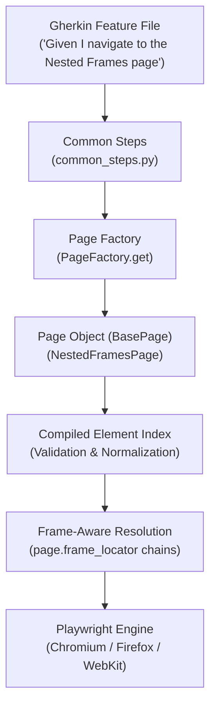

# Playwright Python BDD Framework (Behave + POM)

A robust, enterprise-ready end-to-end test automation framework built with **Python**, **Playwright**, and **Behave (BDD)**, implementing a declarative **Page Object Model (POM)** with native support for **multi-level nested iframes**, **dynamic page loading**, **Pydantic configuration**, and **rich HTML reporting with embedded failure screenshots**.

---

## 📑 Table of Contents

- [Framework Architecture](#-framework-architecture)
- [Reporting Dependencies Used](#-reporting-dependencies-used)
- [Directory Structure](#-directory-structure)
- [Prerequisites & Installation](#-prerequisites--installation)
- [Configuration Management](#-configuration-management)
- [Multi-Level Nested Iframes (Parent, Child, Grandchild)](#-multi-level-nested-iframes)
- [Declarative Page Object Model & Page Factory](#-declarative-page-object-model--page-factory)
- [Universal Step Definitions](#-universal-step-definitions)
- [Error Handling & Failure Diagnostics](#-error-handling--failure-diagnostics)
- [Running Tests](#-running-tests)
- [GitLab CI/CD Integration](#-gitlab-cicd-integration)

---

## 🏛 Framework Architecture



### Key Architectural Highlights
1. **Separation of Concerns**: Step definitions remain generic and reusable across the entire suite (`When I click the "Submit" button`), delegating element locators and iframe hierarchy entirely to declarative Page Objects.
2. **Frame-Aware Locator Resolution**: Locators natively resolve through chained `FrameLocator` objects without context switching (`switch_to.frame`) and handle cross-origin or deeply nested frames gracefully.
3. **Compile-Time Validation & Fuzzy Matching**: Page subclasses validate naming conventions (`btn_`, `fld_`, `drp_`, `lnk_`, `chk_`) at import time and suggest corrections when a typo occurs.
4. **Environment-Driven Execution**: Uses `pydantic-settings` to toggle environments, browsers, timeouts, and execution parameters locally or in CI/CD without code edits.

---

## 📊 Reporting Dependencies Used

This framework uses three complementary reporting and diagnostic tools:

| Tool / Dependency | Purpose | Output Location |
| :--- | :--- | :--- |
| **`behave-html-pretty-formatter`** (`>=1.16.1`) | Generates a modern, interactive single-page HTML report with search/filters, Dark Mode, High Contrast, step timings, **embedded failure screenshots**, and **inlined execution & browser console logs**. | [`reports/report.html`](reports/report.html) |
| **Playwright Tracing** (`playwright`) | Captures DOM snapshots, action screencasts, console logs, and network waterfalls for failed scenarios. | [`reports/traces/*.zip`](reports/traces/) |
| **Python Logging Utility** (`utils/logger.py`) | Timestamped execution logs written simultaneously to standard output, disk, and in-memory scenario buffer for HTML report embedding. | [`reports/test_run.log`](reports/test_run.log) |

### Why `behave-html-pretty-formatter`?
* **Zero External Server Required**: Self-contained HTML file viewable in any browser without requiring Jenkins/Allure report servers.
* **Modern UI & Filtering**: Supports instant scenario filtering by status (Passed, Failed, Skipped), Dark Mode, and High Contrast toggles.
* **Smart Failure Screenshot Embedding**: Full-page screenshots captured at the exact failed step are embedded directly into the report DOM with inline previews and one-click download buttons.
* **Embedded Execution & Browser Console Logs**: Framework execution logs and Playwright browser console output are embedded per-step/scenario with automatic gzip compression for large logs.
* **Dynamic Environment Metadata**: Injects runtime execution details (Environment, Browser, Headless, Base URL, Timeout) directly into the report summary header.

---

## 📁 Directory Structure

```text
playwright_framework/
├── config/
│   ├── __init__.py
│   └── settings.py          # Pydantic Settings (APP_* env vars & .env loading)
├── fixtures/
│   └── dummy_site/          # 3-Level nested iframe test fixture
│       ├── index.html       # Level 0: Main host checkout page
│       ├── parent_frame.html# Level 1: Payment gateway (Parent iframe)
│       ├── child_frame.html # Level 2: 3D Secure bank challenge (Child iframe)
│       └── nested_frame.html# Level 3: Biometric / OTP authenticator (Deeply nested frame)
├── features/
│   ├── environment.py       # Playwright browser lifecycle, tracing & screenshot hooks
│   ├── nested_frames.feature# Multi-level iframe BDD test suite
│   ├── checkout.feature     # E-commerce checkout scenario
│   └── steps/
│       ├── __init__.py
│       └── common_steps.py  # Declarative universal step definitions
├── pages/
│   ├── __init__.py          # Public exports
│   ├── base_page.py         # MRO inheritance, frame-chain resolution & navigation
│   ├── page_factory.py      # Dynamic loader + @register_page decorator
│   ├── naming.py            # Prefix matching (btn_, fld_, etc.) & synonyms
│   ├── element.py           # Element descriptors & FrameSection helper
│   ├── home_page.py         # Sample Home page
│   ├── navigation_page.py   # Sample Navigation page
│   ├── add_to_cart_page.py  # Sample Add to Cart page
│   └── nested_frames_page.py# Page object modeling 3 levels of nested iframes
├── utils/
│   ├── __init__.py
│   ├── exceptions.py        # Actionable custom exceptions with fuzzy suggestions
│   └── logger.py            # Console and persistent file logger
├── reports/                 # Auto-generated reports (git-ignored)
│   ├── report.html          # Interactive HTML test report
│   ├── test_run.log         # Timestamped test execution logs
│   ├── screenshots/         # Full-page PNG screenshots on failure
│   └── traces/              # Playwright trace archive zips on failure
├── .env.example             # Template for local environment variables
├── .gitlab-ci.yml           # GitLab CI/CD pipeline with browser matrix & artifacts
├── behave.ini               # Behave runner configuration & HTML formatter registration
└── requirements.txt         # Project dependencies
```

---

## 🚀 Prerequisites & Installation

### 1. Prerequisites
* **Python**: 3.10 or higher
* **Operating System**: macOS, Linux, or Windows

### 2. Setup Virtual Environment
```bash
# Clone or navigate to the project directory
cd playwright_framework

# Create a virtual environment
python3 -m venv .venv

# Activate the virtual environment
# On macOS / Linux:
source .venv/bin/activate
# On Windows:
# .venv\Scripts\activate
```

### 3. Install Dependencies & Playwright Browsers
```bash
# Install required Python packages
pip install -r requirements.txt

# Install Playwright browser binaries
playwright install chromium
# Optionally install all browsers:
# playwright install
```

---

## ⚙️ Configuration Management

Configuration is handled by [`config/settings.py`](config/settings.py) using `pydantic-settings`. It reads from environment variables prefixed with `APP_` or a local `.env` file.

### Available Settings
| Variable Name | Default | Allowed Values / Type | Description |
| :--- | :--- | :--- | :--- |
| `APP_ENV` | `local` | `local`, `dev`, `staging`, `prod`, `ci` | Target environment |
| `APP_BASE_URL` | `http://localhost:8080` | `str` | Base URL of application under test |
| `APP_BROWSER` | `chromium` | `chromium`, `firefox`, `webkit` | Target browser engine |
| `APP_HEADLESS` | `true` | `true`, `false` | Run browser without GUI |
| `APP_TIMEOUT_MS` | `10000` | `int` | Default locator and assertion timeout in ms |
| `APP_SLOW_MO_MS` | `0` | `int` | Delay between Playwright actions in ms |
| `APP_VIEWPORT_WIDTH`| `1280` | `int` | Browser window width |
| `APP_VIEWPORT_HEIGHT`| `720` | `int` | Browser window height |
| `APP_TRACE_ON_FAILURE`| `true` | `bool` | Record Playwright trace zip on test failure |
| `APP_SCREENSHOT_ON_FAILURE`| `true` | `bool` | Capture full-page screenshot on failure |
| `APP_COMPANY_LOGO` | `assets/company_logo.svg` | `str` | Path (SVG, PNG) or URL for company logo on HTML report |
| `APP_REPORTS_DIR` | `reports` | `str` | Directory to store reports, screenshots, and logs |
| `APP_LOG_LEVEL` | `INFO` | `DEBUG`, `INFO`, `WARNING`, `ERROR` | Framework log verbosity |

### Setting Up Local Environment
Copy `.env.example` to `.env`:
```bash
cp .env.example .env
```
Modify `.env` to suit your local workflow (e.g., set `APP_HEADLESS=false` to watch the browser).

---

## 🖼 Multi-Level Nested Iframes

In modern web applications (checkout flows, banking gateways, embedded widgets), elements are often buried inside nested iframes.

### The Iframe Hierarchy
```text
Top Page (Level 0)
└── iframe#parent-frame               (Level 1: Payment Gateway)
    └── iframe#child-frame            (Level 2: 3D Secure Challenge)
        └── iframe#nested-frame       (Level 3: Biometric / OTP Authenticator)
            └── input[data-testid="otp-code"]
```

### 1. The Declarative Page Object with `FrameSection`
Use `FrameSection` to eliminate boilerplate by applying the iframe path to a group of elements:

```python
# pages/nested_frames_page.py
import os
from pages.base_page import BasePage
from pages.element import Css, FrameSection, Placeholder, Role, TestId
from pages.page_factory import register_page

FIXTURE_HTML_PATH = os.path.abspath(
    os.path.join(os.path.dirname(__file__), "..", "fixtures", "dummy_site", "index.html")
)

@register_page("Nested Frames", "Multi Level Frames")
class NestedFramesPage(BasePage):
    url_path = f"file://{FIXTURE_HTML_PATH}"

    elements = {
        # Level 0 (Main Page)
        "lbl_title": Css("#main-title"),
        "fld_customer": Placeholder("Your Name"),
        "btn_view_policy": Role("button", name="View Policy"),

        # Level 1 (Parent Iframe)
        "fld_card_number": Placeholder("Enter 16-digit card", frames=["#parent-frame"]),
        "btn_validate_card": Role("button", name="Validate Card", frames=["#parent-frame"]),

        # Level 2 & 3 Grouped via FrameSection
        **FrameSection(["#parent-frame", "#child-frame"], {
            # Level 2 (Child Frame)
            "fld_bank_reference": Placeholder("Bank Reference ID"),
            "btn_initiate_challenge": Role("button", name="Initiate Challenge"),

            # Level 3 (Deeply Nested inside Level 2)
            "fld_otp": TestId("otp-code", frames=["#nested-frame"]),
            "btn_confirm_payment": Role("button", name="Confirm Payment", frames=["#nested-frame"]),
            "lbl_verification_status": Css("#status-msg", frames=["#nested-frame"]),
        }),
    }
```

### 2. The BDD Feature Scenario
```gherkin
# features/nested_frames.feature
Feature: Multi-Level Nested Iframe Testing

  Scenario: Interact with Parent, Child, and Deeply Nested Grandchild Iframes
    Given I navigate to the "Nested Frames" page
    Then the "Title" label should have text "Store Checkout"

    # Level 0 (Main Page)
    When I fill the "Customer" field with "Alice Johnson"
    And I click the "View Policy" button

    # Level 1 (Parent Iframe)
    And I fill the "Card Number" field with "4111222233334444"
    And I click the "Validate Card" button

    # Level 2 (Child Iframe)
    And I fill the "Bank Reference" field with "REF-98765"
    And I click the "Initiate Challenge" button

    # Level 3 (Deeply Nested Iframe)
    And I fill the "OTP" field with "999888"
    And After I click the "Confirm Payment" button it is disabled
    Then the "Verification Status" label should be visible
    And the "Verification Status" label should have text "Verification Success: Payment Authorized"
```

---

## 🏭 Declarative Page Object Model & Page Factory

### 1. Element Descriptors
The framework maps element factories 1:1 onto Playwright's user-facing locators:
* `Role("button", name="Submit")` &rarr; `page.get_by_role("button", name="Submit")`
* `Placeholder("Email")` &rarr; `page.get_by_placeholder("Email")`
* `Label("Password")` &rarr; `page.get_by_label("Password")`
* `TestId("submit-btn")` &rarr; `page.get_by_test_id("submit-btn")`
* `Text("Welcome")` &rarr; `page.get_by_text("Welcome")`
* `Css(".btn-primary")` &rarr; `page.locator(".btn-primary")`
* `XPath("//button[@id='save']")` &rarr; `page.locator("xpath=//button[@id='save']")`

### 2. Naming Conventions & Synonyms
Elements must begin with an approved prefix:
* `btn_`: Buttons
* `fld_`: Fields, inputs, textboxes
* `drp_`: Dropdowns, selects
* `lnk_`: Hyperlinks
* `chk_`: Checkboxes
* `rdo_`: Radio buttons
* `lbl_`: Labels, static text
* `tab_`: UI Tabs
* `icn_`: Icons

### 3. Dynamic Page Factory with `@register_page`
The `PageFactory` handles page discovery:
1. **Explicit Registry**: Checks classes registered with `@register_page("Page Name", "Alias")`.
2. **Convention Fallback**: Automatically resolves `"Add to Cart"` &rarr; `pages.add_to_cart_page.AddToCartPage`.
3. **Scenario Caching**: Caches page instances for the duration of a scenario.

---

## ✍️ Universal Step Definitions

A concise set of universal steps in [`features/steps/common_steps.py`](features/steps/common_steps.py) handles almost all UI interactions without writing new Python code for each page:

| Step Pattern | Example Usage |
| :--- | :--- |
| `Given I navigate to the "{page_name}" page` | `Given I navigate to the "Nested Frames" page` |
| `Given I am on the "{page_name}" page` | `Given I am on the "Home" page` |
| `When I click the "{label}" {etype}` | `When I click the "Submit" button` |
| `When I fill the "{label}" {etype} with "{value}"` | `When I fill the "Card Number" field with "41112222"` |
| `When I check the "{label}" {etype}` | `When I check the "Terms" checkbox` |
| `When I select "{option}" from the "{label}" {etype}` | `When I select "USA" from the "Country" dropdown` |
| `When After I click the "{label}" {etype} it is disabled` | `When After I click the "Pay" button it is disabled` |
| `Then the "{label}" {etype} should be visible` | `Then the "Confirmation" label should be visible` |
| `Then the "{label}" {etype} should have text "{text}"`| `Then the "Title" label should have text "Store Checkout"` |

---

## 🚨 Error Handling & Failure Diagnostics

When an assertion or locator fails, the framework produces rich diagnostics:

### 1. Custom Exceptions with Fuzzy Matching
If a step calls an element key not registered in the Page Object:
```text
utils.exceptions.ElementNotFoundError: 
❌ [Element Not Found] Key 'fld_card' is not registered in page 'CheckoutPage'.
   📋 Available registered elements:
      btn_pay, fld_card_number, fld_otp, lbl_order_row
   💡 Did you mean: 'fld_card_number'?
   🔍 Check CheckoutPage.elements dictionary for spelling or prefix mismatch.
```

### 2. Automatic Full-Page Screenshots & HTML Embedding
On step failure, `after_step` in [`features/environment.py`](features/environment.py):
1. Captures a full-page PNG and saves it to `reports/screenshots/<scenario>_<step>.png`.
2. Automatically attaches it to the failing step via `context.embed(mime_type="image/png", data=screenshot_path)`.
3. Attaches in-memory Python execution logs and browser console errors directly to the step in `reports/report.html`.

### 3. Playwright Traces
Traces are captured and saved to `reports/traces/<scenario_name>.zip`. To inspect:
```bash
playwright show-trace reports/traces/<scenario_name>.zip
```

---

## 🏃 Running Tests

```bash
# 1. Activate virtual environment
source .venv/bin/activate

# 2. Run all features and generate Pretty HTML report + console output
behave -f html-pretty -o reports/report.html -f pretty

# 3. Run a specific feature file
behave features/nested_frames.feature -f html-pretty -o reports/report.html -f pretty

# 4. Run tests with tags
behave --tags=@smoke -f html-pretty -o reports/report.html -f pretty

# 5. Run headed (visible browser) via environment variable
APP_HEADLESS=false behave features/nested_frames.feature -f html-pretty -o reports/report.html

# 6. Run on a different browser (firefox or webkit)
APP_BROWSER=firefox behave features/nested_frames.feature -f html-pretty -o reports/report.html
```

---

## 🚢 GitLab CI/CD Integration

The repository includes a ready-to-use [`.gitlab-ci.yml`](.gitlab-ci.yml):

```yaml
stages:
  - test

default:
  image: mcr.microsoft.com/playwright/python:v1.40.0-jammy

variables:
  APP_ENV: "ci"
  APP_BASE_URL: "https://staging.myapp.com"
  APP_BROWSER: "chromium"
  APP_HEADLESS: "true"
  APP_TIMEOUT_MS: "15000"

before_script:
  - python3 -m venv .venv
  - source .venv/bin/activate
  - pip install -r requirements.txt

test:staging:
  stage: test
  script:
    - source .venv/bin/activate
    - behave -f html -o reports/report.html -f pretty
  artifacts:
    when: always
    expire_in: 14 days
    paths:
      - reports/
```

### How to Override Variables in GitLab:
1. **Via UI**: Set `APP_BASE_URL` or `APP_BROWSER` in **Settings** &rarr; **CI/CD** &rarr; **Variables**.
2. **Via Pipeline Run**: Pass variable values directly when clicking **Run Pipeline** in the GitLab console.
3. **Download Artifacts**: Navigate to the completed pipeline job to download or view `reports/report.html`, failure screenshots, and execution logs.
